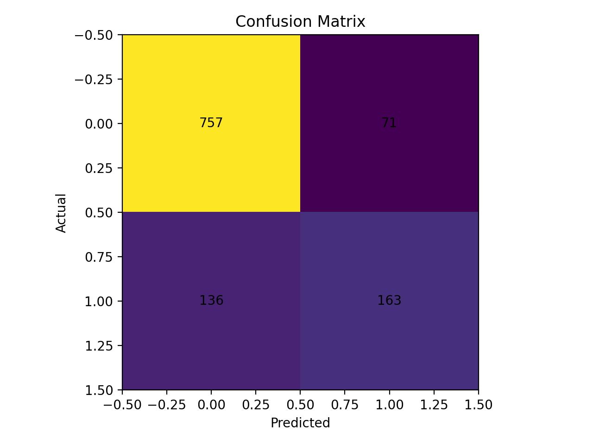
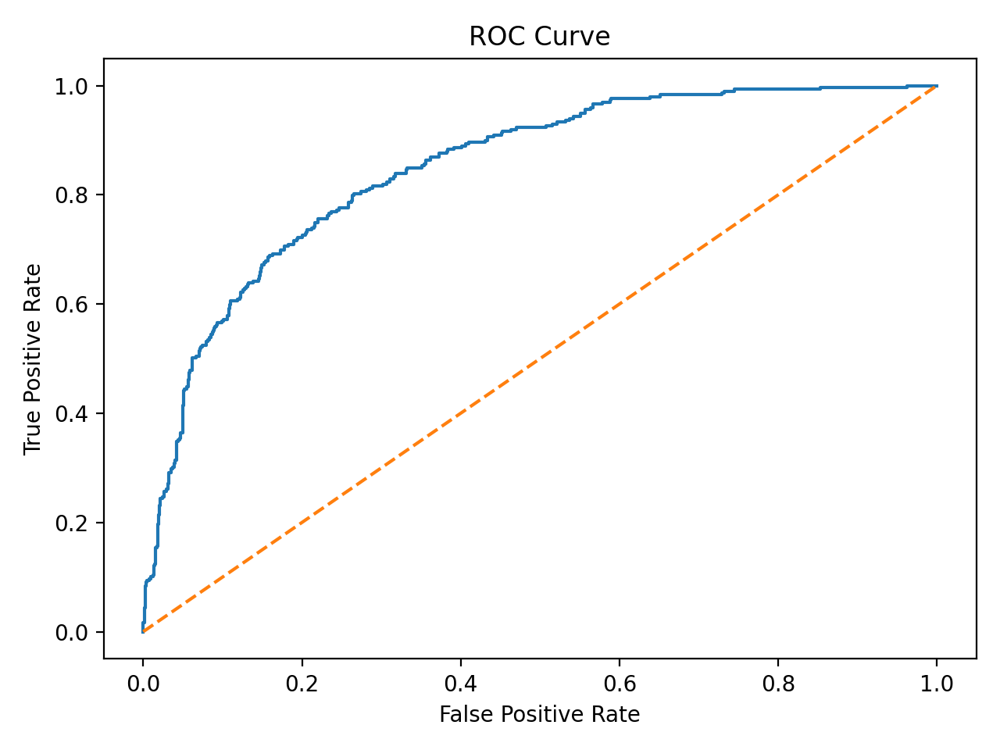
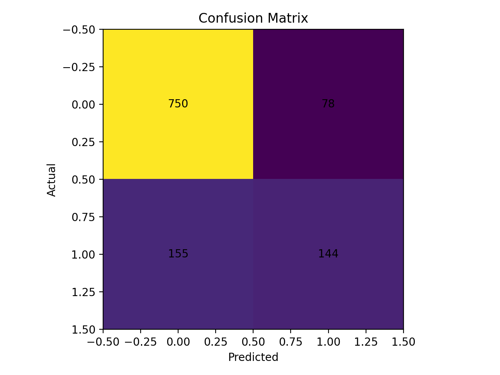
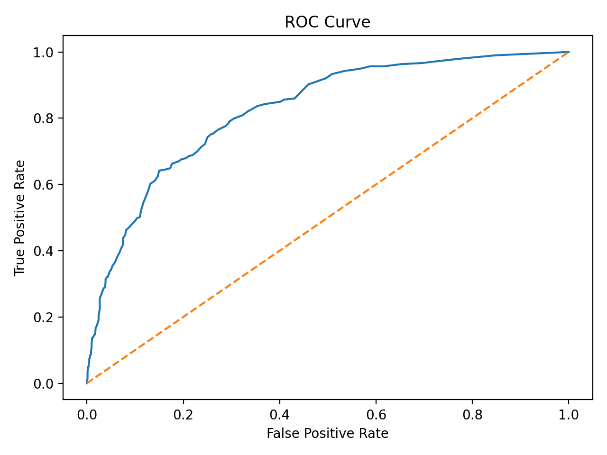
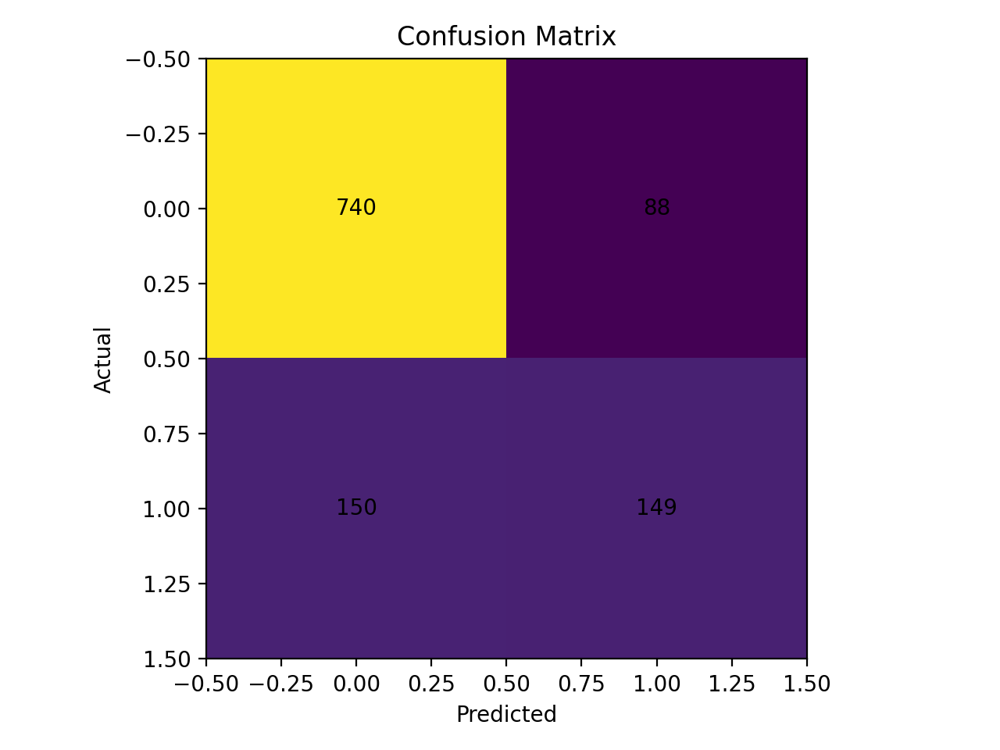
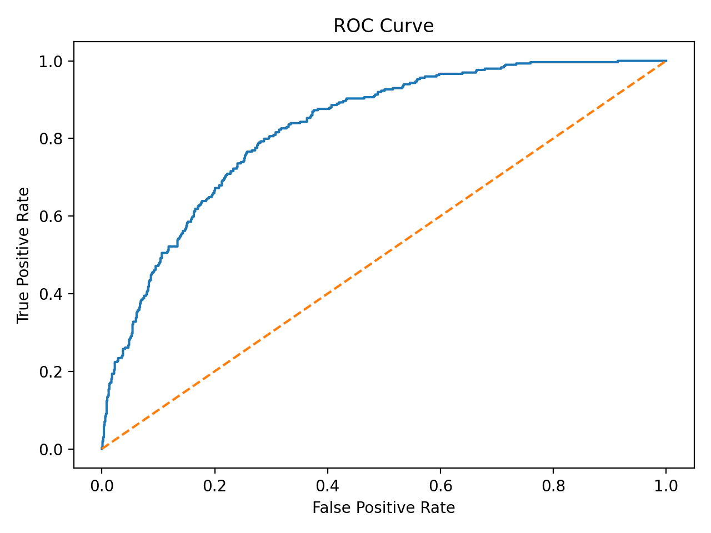

# Customer Churn Prediction with MLOps Pipeline

End-to-end customer churn prediction project covering data validation, preprocessing, model training and comparison, evaluation, experiment tracking, workflow orchestration, and model serving through an API.

## Highlights

- **Data validation:** data quality report generated from the raw churn dataset
- **Preprocessing:** train/test split with saved preprocessing artifacts
- **Model comparison:** Logistic Regression, Random Forest and XGBoost
- **Experiment tracking:** MLflow logs metrics, plots and trained models
- **Reproducible pipeline:** DVC stages for ingestion, preprocessing, training and evaluation
- **Orchestration:** Airflow DAG (`churn_mlops_end_to_end`) that runs the full workflow
- **Serving:** FastAPI inference service with `/health` and `/predict`
- **Containers:** Docker support for the API and Airflow

## Architecture

```
Raw CSV --> Data ingestion/validation --> Preprocessing --> Training (3 models) --> Evaluation
                                              |                    |                    |
                                       preprocessor.pkl       best_model.pkl     metrics + plots
                                                                   |
                                                            FastAPI /predict

DVC defines the stages | MLflow tracks the runs | Airflow orchestrates the DVC stages
```

## Project Structure

```
ML-Final-Assignment/
├── .dvc/                  # DVC configuration
├── airflow/               # Docker Compose setup for Airflow
│   └── docker-compose.airflow.yml
├── airflow_dags/          # Orchestration DAG and task wrappers
├── api/                   # FastAPI inference service
│   ├── main.py
│   └── Dockerfile.api     # API-specific Docker setup
├── data/
│   ├── raw/               # Source dataset (not tracked in Git)
│   └── processed/         # Transformed train/test datasets (DVC output)
├── models/                # Saved model, preprocessor, feature schema, registry output
├── notebooks/             # Exploration notebooks
├── reports/               # Evaluation metrics, plots and validation reports
├── src/                   # Pipeline scripts
│   ├── data_ingestion.py
│   ├── preprocessing.py
│   ├── train.py
│   └── evaluate.py
├── .dvcignore
├── .env.example           # Template for required environment variables
├── .gitignore
├── Dockerfile
├── dvc.lock
├── dvc.yaml               # DVC pipeline definition
├── requirements.txt
├── test_api.py            # API test script
└── README.md
```

## Setup

```bash
python -m venv venv

# Windows
venv\Scripts\activate
# macOS / Linux
source venv/bin/activate

python -m pip install --upgrade pip
pip install -r requirements.txt
```

### Environment variables

Copy `.env.example` to `.env` and fill in the values. The `.env` file is git-ignored.

```
GEMINI_API_KEY=your_key_here
AIRFLOW_SECRET_KEY=change-me
```

`GEMINI_API_KEY` is read by the API from the environment and is never stored in the repository.

## Dataset

The raw dataset is not stored in Git. Download it from the source below and place it at:

```
data/raw/Churn_Prediction_DataSet.csv
```

> Dataset source: _add the download link here_

## Run the DVC Pipeline

```bash
dvc repro
```

This runs four stages in order: `data_ingestion`, `preprocessing`, `train`, `evaluate`. Outputs:

| Stage | Outputs |
|-------|---------|
| `data_ingestion` | `reports/data_quality_report.json` |
| `preprocessing` | `data/processed/train.csv`, `data/processed/test.csv`, `models/preprocessor.pkl`, `models/feature_names.json` |
| `train` | `models/best_model.pkl` |
| `evaluate` | `reports/metrics.json`, `reports/confusion_matrix.png`, `reports/roc_curve.png` |

View the latest metrics with:

```bash
dvc metrics show
```

### Run individual steps

```bash
python src/data_ingestion.py --input data/raw/Churn_Prediction_DataSet.csv --report_out reports/data_quality_report.json
python src/preprocessing.py --input data/raw/Churn_Prediction_DataSet.csv --outdir data/processed
python src/train.py --train data/processed/train.csv --model_out models/best_model.pkl
python src/evaluate.py --test data/processed/test.csv --model models/best_model.pkl --outdir reports
```

## Results

Three models are trained and compared (Logistic Regression, Random Forest and XGBoost). The best one is saved as `models/best_model.pkl`.

| Best model | Accuracy | Precision | Recall | F1 | ROC-AUC |
|------------|----------|-----------|--------|----|---------|
| _model name_ | 0.799 | 0.644 | 0.543 | 0.589 | 0.842 |

Per-model confusion matrices and ROC curves are in `reports/`.

Per-model plots are in `reports/`:

| Model | Confusion matrix | ROC curve |
|-------|------------------|-----------|
| Logistic Regression |  |  |
| Random Forest |  |  |
| XGBoost |  |  |

## Experiment Tracking

Training and evaluation log metrics, plots and models to MLflow. To browse runs locally:

```bash
mlflow ui
```

Then open http://localhost:5000.

## Run the API

The API needs the preprocessing artifacts and trained model in `models/`, so run the DVC pipeline first.

```bash
uvicorn api.main:app --reload
```

Endpoints:

- `GET /health` - service health check
- `POST /predict` - churn prediction
- `GET /docs` - interactive Swagger documentation

Example request body for `POST /predict`:

```json
{
  "features": {
    "gender": "Female",
    "Partner": "Yes",
    "Dependents": "No",
    "PhoneService": "Yes",
    "MultipleLines": "No",
    "InternetService": "Fiber optic",
    "OnlineSecurity": "No",
    "OnlineBackup": "Yes",
    "DeviceProtection": "No",
    "TechSupport": "No",
    "StreamingTV": "Yes",
    "StreamingMovies": "Yes",
    "Contract": "Month-to-month",
    "PaperlessBilling": "Yes",
    "PaymentMethod": "Electronic check",
    "SeniorCitizen": 0,
    "tenure": 12,
    "MonthlyCharges": 79.85,
    "TotalCharges": 956.4
  }
}
```

Test the running API with:

```bash
python test_api.py
```

## Run the API with Docker

```bash
docker build -f api/Dockerfile.api -t churn-api .
docker run -p 8000:8000 --env-file .env churn-api
```

## Run Airflow

From the `airflow/` directory:

```bash
docker compose -f docker-compose.airflow.yml up
```

The DAG ID is `churn_mlops_end_to_end`. Airflow runs the DVC stages from inside the mounted project directory.

For local use only, the default Airflow login is `airflow` / `airflow`. Do not use these credentials or the default secret key in any deployed environment.

## Notes

- The API expects the preprocessing artifacts and trained model to exist in `models/`.
- Large files (datasets, `.pkl` models) are managed by DVC, not Git. Cloning the repo gives you the code and pipeline definition. You need the raw dataset to reproduce the results.
- Copy `.env.example` to `.env` before running the API or Airflow.
